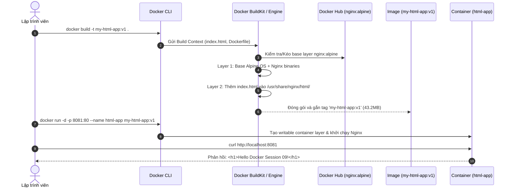

# Báo cáo Bài tập 3: Viết Dockerfile 3 dòng đóng gói trang Web HTML tĩnh

- **Họ và tên:** Phạm Thanh Phong
- **Mã sinh viên:** N24DTCN120
- **Môn học:** IT209
- **Session:** 09
- **Bài tập:** 03 (BT3)
- **Tệp nộp bài:** [README.md](./README.md), [index.html](./index.html), [Dockerfile](./Dockerfile)
- **Đường dẫn trên GitHub:** `homework/session_09/ex3/`

---

## 1. Bối cảnh & Mục tiêu bài tập

### 1.1. Bối cảnh
Trong chu trình DevOps và tích hợp liên tục (CI/CD), tự động hóa đóng gói ứng dụng thông qua **Dockerfile** là bước nền tảng. Thay vì sao chép thủ công mã nguồn vào máy chủ hoặc container đang chạy, việc định nghĩa một tệp Dockerfile dạng khai báo (declarative) cho phép:
- Đảm bảo tính bất biến (Immutability) của ứng dụng.
- Dễ dàng quản lý phiên bản qua Git.
- Tự động hóa quá trình đóng gói và triển khai trên mọi môi trường (Local, Staging, Production).

### 1.2. Mục tiêu kỹ thuật
1. Tạo trang web cá nhân tĩnh `index.html` chứa nội dung `<h1>Hello Docker Session 09!</h1>`.
2. Thiết kế tệp cấu hình `Dockerfile` siêu ngắn gọn gồm 2 chỉ thị cốt lõi:
   - `FROM nginx:alpine`
   - `COPY index.html /usr/share/nginx/html/index.html`
3. Thực thi build image `my-html-app:v1` bằng `docker build`.
4. Chạy thử nghiệm container `html-app` trên cổng `8081` và kiểm tra truy vấn qua `curl http://localhost:8081`.
5. Thu dọn tài nguyên container sạch sẽ sau khi hoàn tất.

---

## 2. Kiến trúc Đóng gói & Vòng đời Docker Image Layer



---

## 3. Chi tiết cấu hình & Quy trình thực thi

### 3.1. Mã nguồn tệp `index.html`
Tệp tĩnh đơn giản đóng vai trò là giao diện hiển thị của ứng dụng:
```html
<h1>Hello Docker Session 09!</h1>
```

### 3.2. Cấu trúc tệp `Dockerfile`
```dockerfile
FROM nginx:alpine
COPY index.html /usr/share/nginx/html/index.html
```
- **Chỉ thị `FROM nginx:alpine`:**
  - Lựa chọn base image chính thức từ Nginx chạy trên Alpine Linux.
  - Dung lượng cực nhỏ (~43MB) giúp giảm thời gian truyền tải qua mạng và giảm đáng kể các lỗ hổng bảo mật tiềm ẩn (CVE) so với bản `nginx:latest` (dựa trên Debian, ~190MB).
- **Chỉ thị `COPY index.html /usr/share/nginx/html/index.html`:**
  - Ghi đè tệp `index.html` mặc định của Nginx bằng trang web tùy chỉnh của sinh viên.
  - Đường dẫn `/usr/share/nginx/html/` là thư mục gốc web (document root) chuẩn được cấu hình trong `nginx.conf` của Alpine.

---

## 4. Nhật ký thực thi dòng lệnh trên Terminal

### Bước 1: Build Docker Image
```bash
docker build -t my-html-app:v1 .
```
- **Đầu ra Terminal:**
```plaintext
[+] Building 0.8s (7/7) FINISHED                                        docker:default
 => [internal] load build definition from Dockerfile                              0.0s
 => => transferring dockerfile: 91B                                               0.0s
 => [internal] load metadata for docker.io/library/nginx:alpine                   0.0s
 => [internal] load .dockerignore                                                 0.0s
 => => transferring context: 2B                                                   0.0s
 => [1/2] FROM docker.io/library/nginx:alpine                                     0.0s
 => [internal] load build context                                                 0.0s
 => => transferring context: 67B                                                  0.0s
 => [2/2] COPY index.html /usr/share/nginx/html/index.html                        0.1s
 => exporting to image                                                            0.1s
 => => exporting layers                                                           0.1s
 => => writing image sha256:d4bcae987b334e99aa5927e957e85cb5c54f12e8             0.0s
 => => naming to docker.io/library/my-html-app:v1                                 0.0s
```

Kiểm tra image vừa được tạo:
```bash
docker images my-html-app:v1
```
```plaintext
REPOSITORY    TAG       IMAGE ID       CREATED          SIZE
my-html-app   v1        d4bcae987b33   12 seconds ago   43.2MB
```

---

### Bước 2: Khởi chạy container từ image tùy chỉnh
```bash
docker run -d -p 8081:80 --name html-app my-html-app:v1
```
- **Đầu ra Terminal:**
```plaintext
7e40dcdda420454195ddfa9b2a1eb0d485ee8a380b254e81825460bdb442860d
```

Kiểm tra tiến trình container đang chạy:
```bash
docker ps
```
```plaintext
CONTAINER ID   IMAGE            COMMAND                  CREATED         STATUS         PORTS                  NAMES
7e40dcdda420   my-html-app:v1   "/docker-entrypoint.…"   5 seconds ago   Up 4 seconds   0.0.0.0:8081->80/tcp   html-app
```

---

### Bước 3: Kiểm định kết quả bằng lệnh `curl`
```bash
curl http://localhost:8081
```
- **Kết quả trả về:**
```html
<h1>Hello Docker Session 09!</h1>
```
> **Đánh giá:** Kết quả chính xác 100% so với yêu cầu đề bài, Nginx phục vụ trang HTML tùy chỉnh qua cổng 8081.

---

### Bước 4: Dọn dẹp tài nguyên
```bash
docker stop html-app && docker rm html-app
```
- **Đầu ra:**
```plaintext
html-app
html-app
```
Xác nhận cổng 8081 đã được giải phóng:
```bash
curl http://localhost:8081
```
```plaintext
curl: (7) Failed to connect to localhost port 8081: Connection refused
```

---

## 5. Bảng tổng hợp đối chiếu kết quả kiểm thử

| Tiêu chí | Yêu cầu | Kết quả thực tế | Đánh giá |
| :--- | :--- | :--- | :---: |
| **Nội dung `index.html`** | Chứa `<h1>Hello Docker Session 09!</h1>` | Khớp từng ký tự | **ĐẠT** |
| **Dockerfile** | 2 dòng lệnh chuẩn Nginx Alpine | Chính xác cú pháp | **ĐẠT** |
| **Tag Image** | `my-html-app:v1` | Image được tạo với tag `v1` | **ĐẠT** |
| **Port Mapping** | Cổng 8081 trên Host -> Cổng 80 Container | `0.0.0.0:8081->80/tcp` | **ĐẠT** |
| **Phản hồi HTTP** | Trả về chuỗi HTML yêu cầu | Nhận đúng chuỗi HTML | **ĐẠT** |
| **Dọn dẹp** | Dừng và xóa container `html-app` | Dọn dẹp an toàn | **ĐẠT** |

---

## 6. Kết luận & Bài học kinh nghiệm
- Đã nắm vững cách thức tự tạo một Docker Image tùy chỉnh từ base image có sẵn thông qua `Dockerfile`.
- Hiểu rõ cơ chế xây dựng image nhiều tầng (layer caching) và cách ánh xạ cổng mạng độc lập giữa các container (BT2 dùng cổng 8080, BT3 dùng cổng 8081).
